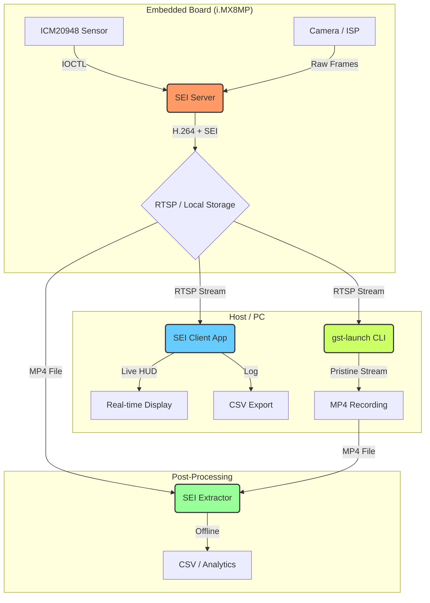

# 🛰️ IMU-Avigna: Unified SEI Metadata Pipeline

[]()
[]()
[]()

**IMU-Avigna** is a high-performance, low-latency framework designed to synchronize and embed high-frequency IMU data (Accelerometer, Gyroscope, Magnetometer) directly into H.264/H.265 video streams. By leveraging **Supplemental Enhancement Information (SEI) NAL units**, this pipeline ensures frame-accurate metadata synchronization for robotics, AR/VR, and stabilized recording applications.

---

## 🏗️ System Architecture

The pipeline consists of three primary stages: **Injection**, **Transmission**, and **Extraction**.



---

## 🚀 Key Features

* **Frame-Accurate Sync:** IMU data is sampled at the exact moment of frame capture and injected as a prefix SEI NAL unit.
* **Hardware Accelerated:** Optimized for the i.MX8M Plus VPU/ISP using GStreamer hardware plugins (`v4l2h264enc`).
* **Real-time HUD:** High-speed Cairo-based overlay for live telemetry visualization on the client side.
* **Zero-Copy Extraction:** Offline extractor parses `.mp4` containers at maximum disk speed without re-encoding.
* **Unified Workspace:** Clean, modular structure separating common headers, server, client, and extractor logic.

---

## 📁 Project Structure

| Directory | Description |
| :--- | :--- |
| [**`sei_unified/`**](./sei_unified/) | **Active Production Code.** Contains the consolidated pipeline. |
| `sei_unified/server/` | Embedded application for metadata injection and streaming. |
| `sei_unified/client/` | Host application for live viewing and HUD overlay. |
| `sei_unified/extractor/` | CLI tool for batch metadata extraction from recordings. |
| `sei_unified/common/` | Shared data structures and binary layout definitions. |
| [`archives/`](./archives/) | Legacy implementations and previous iterations of the pipeline. |
| [`reference/`](./reference/) | Documentation, sample outputs, and reference data. |

---

## ⚡ Quick Start

### 1. Hardware Setup

Ensure you are using an **i.MX8M Plus** development board with an **ICM20948** IMU connected via SPI/I2C and correctly mapped in the device tree.

### 2. Dependencies

Run the dependency installer on both the board and the host PC:

```bash
cd sei_unified/
chmod +x install_dependencies.sh
./install_dependencies.sh
```

### 3. Deploying the Server (Board)

```bash
cd sei_unified/server/
./build_and_run_server.sh
```

### 4. Running the Client (PC)

```bash
cd sei_unified/client/
./build_and_run_client.sh --ip <board_ip>
```

---

## 📊 Data Format

The IMU metadata is packed into a **110-byte binary payload** within a User Data Unregistered SEI NAL unit (UUID: `5345494d-5544-4154-415f-424c-4f43-4b`).

For specific byte offsets and field definitions, see [sei_metadata.h](./sei_unified/common/sei_metadata.h).

---

## 🛠️ Maintenance & Development

The project uses a unified header approach in `sei_unified/common/`. Any changes to the `IMUPayload` struct must be followed by a recompile of all three components (Server, Client, Extractor) to maintain binary compatibility.

### Maintainer

* **Name**: Vishnu Siddavatam (Smart IP Team)
* **Email**: <vishnuvardhan.siddavatam@vconnectech.in>

